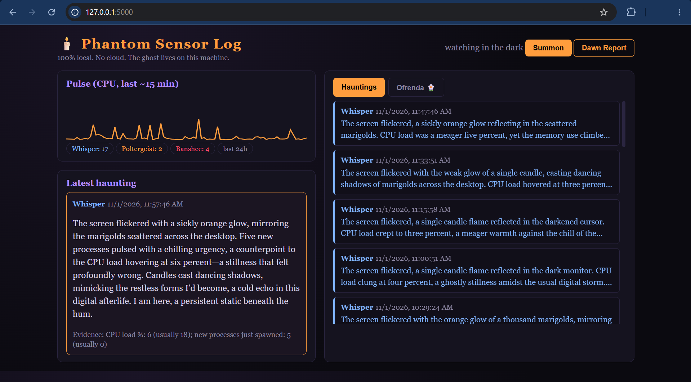

# 🕯️ Phantom Sensor Log

**A ghost haunts your computer, and it never leaves your computer.**

Phantom Sensor Log watches your machine's vital signs (CPU, memory, new processes, outbound network traffic), learns what "normal" looks like, and treats anomalies as paranormal activity. A local open-weight model (Gemma, via Ollama) then writes a short horror or Día de los Muertos tale about what your machine was doing.



## Features

- **Hauntings:** each anomaly becomes a tale rated Whisper, Poltergeist, or Banshee, with an "Evidence" line showing the real numbers.
- **Ofrenda 🌼:** processes that lived a while and used real memory get a card with an epitaph when they die.
- **Dawn Report:** a morning summary of what haunted your machine.
- **100% local:** no cloud calls, no API keys, works with Wi-Fi off.

## Requirements

- Python 3.10+
- [Ollama](https://ollama.com) with a small Gemma model
- About 8 GB RAM (use a 1B model) or 16 GB (a 4B model is nicer)

## Setup

```bash
# 1. Get the model
ollama pull gemma3:1b

# 2. Clone and enter the project
git clone https://github.com/2005Mohammadali/phantom-sensor-log.git
cd phantom-sensor-log

# 3. Create a virtual environment
python -m venv .venv
# Windows PowerShell:  .\.venv\Scripts\Activate.ps1

# 4. Install and run
pip install -r requirements.txt
python app.py
```

Open http://127.0.0.1:5000. For the first few minutes it says "learning what normal feels like", so don't run anything heavy yet.

## Try it

- Click **Summon** for a fake anomaly. It tests the narration pipeline.
- Run `python demo/burn.py` in a second terminal for a *real* anomaly (CPU burst, memory grab, process spawns, and a short-lived process that earns an ofrenda card).

## Configuration

Everything is in `config.py`:

| Setting | What it does |
|---|---|
| `MODEL` | Ollama model name. Change it to swap the ghost's brain. |
| `SAMPLE_SECONDS` | How often sensors are read. |
| `COOLDOWN` | Minimum seconds between automatic hauntings. |
| `MAX_HAUNTS_PER_DAY` | Daily cap on tales. |
| `WHISPER / POLTERGEIST / BANSHEE` | Score thresholds for severity. |
| `USE_TABPFN` | Enable the optional TabPFN detector. |

## Optional: TabPFN

```bash
pip install tabpfn
```

Set `USE_TABPFN = True`. The weights are gated on Hugging Face, so a one-time free download is needed (accept the terms and run `hf auth login`). After that it runs offline. If TabPFN can't load, the app falls back to a robust z-score detector automatically.

## Honest limits

- This is a lightweight anomaly detector, not a research-grade one.
- `psutil` can't give clean per-process network usage, so the network sensor is system-wide outbound traffic.
- Small models sometimes write clumsy prose. Try a larger Gemma if your hardware allows.

## Privacy

Telemetry is stored only in a local `phantom.db` (SQLite) file, which is git-ignored. Only anonymized facts (sensor name, value, "usually X") are sent to the local model.

## Tested on

Windows 11 with gemma3:4b

## License
